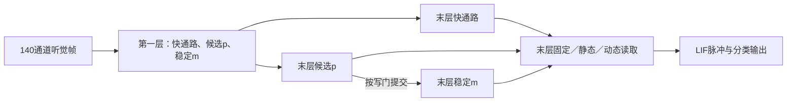

# GDSM：门控双状态记忆

论文名称为 Gated Dual-State Memory（GDSM）；代码与检查点中的 `commit` 配置键保留。

本模块把已封板的 SHD 架构整理为可复用实现，并用于 SSC 的完整数据迁移训练。它没有新增门控算法。原有 `shd/`、`ssc/` 等论文示例保持独立。

支持140通道听觉帧输入、可配置类别数／隐层维度／记忆维度，以及三种末层读取。已验证的研究配置是两层128神经元、每个记忆状态30维、SHD20类或SSC35类。

测试环境为Python3.10。CPU环境可在仓库根目录按以下顺序安装依赖：

```bash
python -m pip install torch==2.0.0 --index-url https://download.pytorch.org/whl/cpu
python -m pip install -r commit_memory/requirements.txt
```

## 状态与读取

对 GDSM，每层有向量候选状态和稳定状态：

\[
u_t=\operatorname{ReLU}(W_u s_t+b_u),\quad
p_t=\bar A p_{t-1}+D_u u_t,\quad
m_t=(1-g_t)m_{t-1}+g_t p_{t-1}.
\]

`u_t`有d个分量，`D_u`为固定对角缩放。局部门与根据当前／历史输入统计计算的许可门相乘，并沿用既有零输入规则；推理接口不接收噪声标签、边界或任务类别。

局部门使用当前4项统计及其历史证据，输出逐维sigmoid；小于0.02的值在前向中截断。许可网络使用当前／历史的总活动、变化、方差、占用率和14个频带统计，输出两层各d个二值许可，反向使用sigmoid代理梯度。原始输入全零时，两层许可都归零。这是保留的人工先验，静音期间的写保护不能单独作为“模型自行学会识别噪声”的证据。训练以已知查询时刻计算类别损失；查询时刻不传入状态更新或读取网络。

末层电流为三个独立投影的加权和：

\[
I_t=r_xW_xs_t+r_pW_pp_t+r_mW_mm_t,
\qquad (r_x,r_p,r_m)=3\operatorname{softmax}(\ell_t).
\]

固定读取的三个系数均为1。静态读取学习3个logit；动态读取沿用12→16→3网络，共259个参数。LIF产生脉冲，再由分类层输出逐帧logit。辅助记忆分类头用于训练／诊断，不替代主输出。



`family='dmp'`使用标量驱动的原始LMU递推，不采用GDSM的写保护；它是结构基线。共同辅助训练和SHD初始化意味着本研究不是论文原训练配方的逐项复现。同一个d也不代表相同容量：GDSM每层有p、m两个d维状态。

## 调用

```python
import torch
from commit_memory import MemoryConfig, MemoryClassifier

model = MemoryClassifier(MemoryConfig(classes=35, family='commit'))
model.set_stage('content')   # 基础分类；保护许可暂不参与
logits = model(frames)      # [batch,time,35]，每次forward开始新序列

model.set_stage('robust')   # 训练原有写保护，仍仅使用类别／查询时刻监督
model.eval()
model.reset_state()
outputs = [model.stream_chunk(chunk) for chunk in chunks]
continuous_logits = torch.cat(outputs, dim=1)
```

`stream_chunk`保留上一块的状态，不根据词边界自动清空。改变批大小、开始独立流或移动设备前先调用`reset_state()`。一个模型实例对应一组连续流；不要让独立请求交错复用它的状态。

读取训练使用`reader='static'`或`'dynamic'`，先载入同一SSC源模型的全部非`adapter`权重，再`set_stage('reader')`。此阶段整个骨干及第一层读取均冻结；只有末层读取系数更新。只冻结写门参数而允许第一层输出改变，不能保证第二层记忆不变，本实现同时冻结了这条间接路径。

```python
checkpoint = torch.load('model.pt', map_location='cpu')
model = MemoryClassifier.from_checkpoint(checkpoint)
```

检查点包含版本号、配置、训练阶段和参数；不含运行中的流状态。加载后从空状态开始。模型可迁移到PyTorch支持的设备；本次执行环境只验证了CPU，不宣称GPU性能或硬件功耗。

需要诊断GDSM的记忆时，可显式保存一次前向的轨迹：

```python
model.eval()
for cell in model.cells():
    cell.capture = True
with torch.no_grad():
    logits = model(frames)
    auxiliary = model.memory_logits([(0, frames.shape[1])])
trace = model.LMU2.trace  # p、m、gate、u，均按[batch,time,dimension]排列
read_weights = model.read_weights  # [batch,time,3]，顺序为快通路、候选、稳定
```

这些轨迹用于观察，不参与额外监督。下一次`forward`或`reset_state()`会清空模型中的旧轨迹。辅助读取接口用于批量前向后的查询；在线推理最后一帧的GDSM状态位于`online_last`，其键为`p`、`m`、`gate`、`read`。

## 命令行推理

在仓库根目录执行：

```bash
python infer_memory.py --checkpoint model.pt --input frames.npy \
  --chunk 17 --window 20 --output predictions.npz
```

`frames.npy`须为`[time,140]`或`[batch,time,140]`的非负帧计数。输出包括类别编号、概率和逐帧logit。`--chunk 0`使用批量计算，正数使用在线状态；`--window 20`读取末20帧，`--window 0`读取全序列平均。

## 适用范围与数值限制

- 研究数据沿用从每个词首个事件到最后事件归一化为100帧、700通道按5个一组取最大值的离线编码。这需要完整词边界；模型支持连续状态不等于编码器已经支持无边界实时语音。
- 在线算法对不同分块方式的输出应一致，并严格因果。优化后的批量算法与逐帧算法存在浮点运算顺序差异，个别接近LIF阈值的脉冲可能变化；同时报告整词概率／预测差异，不把它宣称为任意设备上的位级一致。
- 冻结读取阶段的记忆不变，是工程不变量；不保证源模型已经学会抗噪。实际保持率和旧状态系数需要单独评估。
- 本轮训练、验证、权重及验收报告位于工作区 `experiments/ssc-architecture/`；统一报告同时列出未达到的性能目标。

测试环境和训练方案记录在该目录的`protocol.json`、`verification.json`及训练日志中。`base_model.py`、`reference_model.py`、`vector_ops.py`保留旧研究实现用于数学兼容；公共接口是本目录的`MemoryClassifier`。
