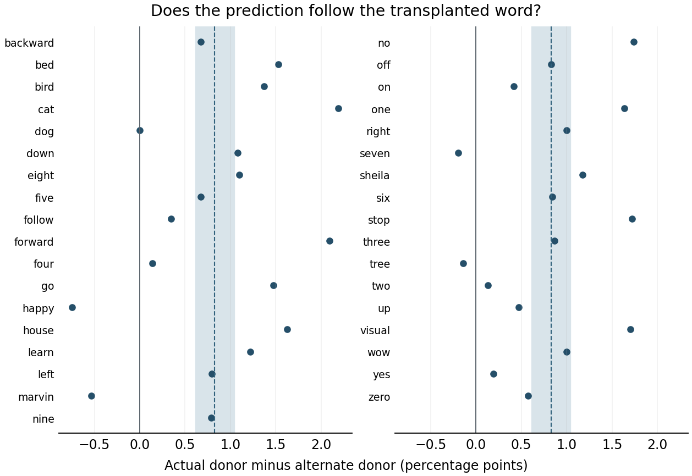

# 把另一个词的稳定记忆换进来，模型会跟着改口吗？

在 SSC 的同一个冻结模型上，换入另一个词的稳定状态，会把后半段的判断小幅推向提供记忆的那个词。模型更常见的反应是对原词识别变差。两种效应可以用同一批语音分开测量。

## 实验

用与词中清零实验相同的 GDSM，每层 128 个神经元、10 维稳定记忆，训练时使用种子 42。只在干净的官方测试语音上推理。对每个原词，找同一说话人说的另外两个不同词，记作甲和乙。按后 125 帧的声学相似度选取，不查看模型输出。26 名说话人的词类不足三种，因此 20,382 条测试语音中有 20,340 条可以配对，来自 472 名说话人，覆盖全部 35 类。

听完原词前 125 帧，保存模型状态。分别保留原词自己的稳定记忆，或换入甲、乙各自听到中点时的稳定记忆。每次同时替换两个隐藏层的稳定状态，只操作一次。候选状态、膜电位和门控历史都来自原词。接下来三次都播放原词的同一段后半段，门照常写入，只从第 126 至 250 帧的平均类别分数判定一个词。

## 结果

| 做什么比较 | 结果 |
|---|---:|
| 保留自己的记忆，认对原词 | 32.83% |
| 换入另一词的记忆，认对原词 | 27.77% |
| 在 40,680 次交换中，最后输出实际提供记忆的词 | 1,939 次（4.77%） |
| 在同一批交换中，最后输出配对但未提供记忆的另一个词 | 1,603 次（3.94%） |
| 实际来源词相对另一个配对词的差值 | +0.83 个百分点，95% 区间 [+0.62, +1.04] |
| 换入记忆后，原词准确率的变化 | −5.06 个百分点，95% 区间 [−5.57, −4.57] |

每条语音在甲、乙两种条件下用同样的权重评分。例如，一条语音无论换入甲还是乙都被判成甲，两次交换合计对主要差值的贡献就是零。这使我们可以识别随记忆来源改变的偏向。与原词自己记忆的读法比较，换入记忆后有 922 次新改判为来源词，同时有 511 次由来源词改判为其他词，净增 411 次。用两个来源词的平均输出分数比较，方向相同，配对分数差为 +0.182（95% 区间 [+0.165, +0.201]，定义见协议）。区间按说话人整组重采样，条件为本次固定权重和配对。

有一条干净语音特别直观。测试索引 10487 的原词是 **down**。保留自身记忆时模型输出 **down**，换入 **on** 的记忆输出 **on**，换入 **go** 的记忆输出 **go**。三次接收的后半段完全相同。在 20,340 条语音中，只有这一条同时满足原词和两次来源词三次都按此方向命中。总体效应应看上表。

按原词分组，35 类中有 30 类的点估计为正，4 类为负，1 类为零。图中的点表示各原词类别的描述性结果。虚线和阴影分别表示按测试语音加权的总体差值及其说话人重采样区间。



这个结果说明，稳定状态对分类的影响带有来源词相关的信息。一次交换还同时改变了与该词相关的声学特征和模型在词中点已经形成的判断，当前实验无法区分两者的贡献。核对时，未交换的全部 20,382 条输出都重现了原清零研究的干净基线预测。对前 16 个合格样本另用批量递推验证一次交换，后半段平均分数的最大绝对差为零。

## 复现

从仓库根目录运行。第一条使用官方 `ssc_test.h5` 生成 250 帧、140 通道的求和输入。环境与原 SSC 词中清零实验一致。

```sh
mkdir -p PREPARED_DIR
python large_scale/ssc_matched200/prepare.py RAW_SSC_DIR PREPARED_DIR test
PYTHONPATH=. OPENBLAS_NUM_THREADS=1 python large_scale/ssc_matched200/memory_swap/evaluate.py PREPARED_DIR
python large_scale/ssc_matched200/memory_swap/summarize.py
python large_scale/ssc_matched200/memory_swap/plot.py
```

脚本从相邻的 midpoint 目录读取权重和已归档的原词预测，并核对权重和输入的 SHA-256。`predictions.npz` 的索引均为官方测试集的零起点索引。预测三列依次为自身、甲、乙两种交换。词类名称来自官方 HDF5 的 `extra/keys`。评分和配对细节见 [实验协议](protocol.md)，数值见 [统计结果](results.json)，逐词数据见 [CSV](by_word.csv)。
