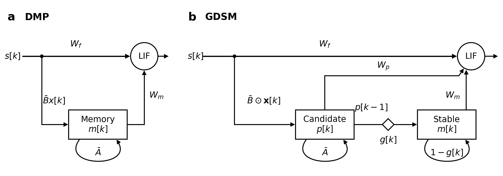
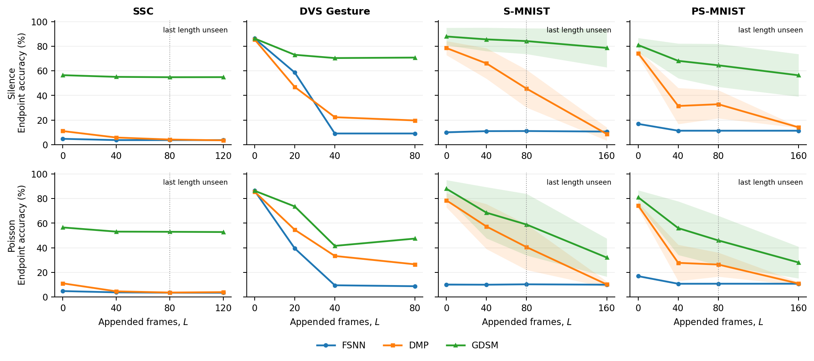
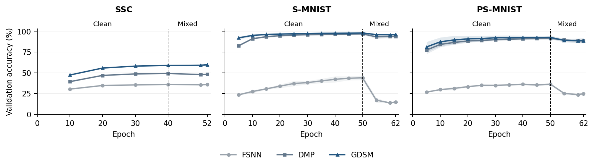
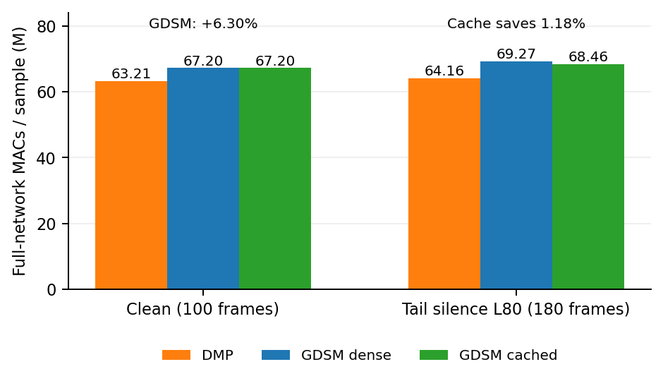

# 面向鲁棒时序处理的脉冲神经网络门控双状态记忆

本文为英文论文的中文对照稿。正文与附录保持原有段落顺序；方括号编号用于逐段修改，例如 `1-P2` 对应引言第二段。公式、图表和参考文献编号与英文稿一致。图内英文标签保留，图注提供中文说明。

# 摘要

**\[摘要\]** SNN 可能已经正确识别了一个事件，却在随后出现的静音或噪声中丢失类别信息。我们提出门控双状态记忆（gated dual-state memory，GDSM），把层内共享的记忆分成两个状态：持续更新的候选状态，以及选择性更新的稳定状态。这样，网络在处理新输入的同时，也能保护先前的信息。我们在脉冲语音、事件相机手势和序列化图像任务中，在原始事件之后追加干扰，并在干扰末尾进行分类。在 Spiking Speech Commands 上，经过 120 帧噪声后，GDSM 的准确率仍为 52.79%，而双记忆通路（dual memory pathways，DMP）为 3.91%。在 DVS Gesture 上，80 帧静音后的准确率从 19.70% 提升至 70.83%。SHD 对照实验表明，更丰富的输入和写入保护发挥了互补作用；三个训练种子的 MNIST 实验进一步验证了较长序列中的记忆保持收益。这些结果说明，将信息整合与存储分开，可以显著增强共享脉冲记忆的持续保持能力。

**关键词：** 脉冲神经网络；共享记忆；门控状态更新；抗干扰。

# 1 引言

**\[1-P1\]** 脉冲神经网络（SNN）随输入到来而处理感知事件。但在许多时序任务中，事件结束后，其中的有用信息仍然需要保留：语音命令之后可能出现背景噪声，手势之后可能出现停顿。因此，正确识别事件只是任务的一部分。当后续输入几乎不再提供相关证据时，网络还需要维持对刚才事件的判断。

**\[1-P2\]** 生物工作记忆也面临这种矛盾：既要接收相关的新信息，又要保护正在指导行为的已有信息。有关前额叶功能的理论强调，脑需要主动维持与当前任务有关的上下文\[1\]。前额叶—基底节回路的计算模型进一步说明，选择性门控可以调节工作记忆何时更新\[2\]。其中的关键思想是：处理一个输入，并不意味着必须把它存进记忆。这给 SNN 提供了一个具体的设计原则：让一个状态跟踪不断到来的证据，让另一个状态保存当前上下文，并控制两者之间的信息传递。本文将这一原则用于单个输入序列内的记忆维持，重点是在停顿或干扰期间保留已经识别出的事件信息。

**\[1-P3\]** 已有研究通过更丰富的脉冲动力学\[3, 4\]，或对输入历史进行紧凑表示\[5, 6, 7\]，来增强时序处理能力。双记忆通路（DMP）把后一种思路引入 SNN，在每层加入一块小型共享记忆\[8\]，以较低的存储开销向快脉冲通路提供历史信息。然而，无论当前输入是有效信号还是干扰，这个共享状态都会继续更新。因此，已经积累起来的信息可能在被使用之前就发生改变。

**\[1-P4\]** 基于上述原则，我们提出门控双状态记忆（GDSM），将持续的信息整合与受保护的存储分开。候选状态跟踪输入证据，稳定状态则选择性地接收候选状态的更新；脉冲层可以同时读取两者。借鉴循环模型与状态空间模型中的选择性更新机制\[9, 10, 11\]，这一设计允许网络处理新输入，而不必随之改写已保存的上下文。此外，向量输入投影使共享记忆能够接收不同的输入特征组合。

**\[1-P5\]** 为了检验这一区别，我们在完整事件之后追加静音或噪声，再根据干扰末尾的输出进行分类。即使当前状态已经丢失答案，对整段序列求平均仍可能把较早的正确预测计入结果；末端评估则直接检验当前表征是否仍然可用。我们同时进行常规分类测试，以及在事件中间插入干扰的测试。

**\[1-P6\]** 实验在语音、事件相机手势和序列化图像上都表现出明显的记忆保持收益，也覆盖了训练时没有出现过的干扰长度。在 SSC 上，120 帧噪声后 GDSM 的准确率为 52.79%，DMP 为 3.91%。在 Gesture 上，两者在干扰前的末端准确率接近，但经过 80 帧静音后，GDSM 仍保持 70.83%，DMP 则为 19.70%。SHD 对照实验进一步揭示了丰富记忆输入和保护写入这两方面的互补贡献。定点实现也验证了该机制可以在硬件中实现。综合来看，选择性存储能够有效增强 SNN 的共享记忆。

# 2 门控双状态记忆

## 2.1 候选—稳定共享记忆

**\[2.1-P1\]** 用 $s_t\in\mathbb{R}^M$ 表示当前层的输入，$s_t^{(0)}$ 表示原始传感器帧。一个隐藏层包含 $N$ 个 LIF 神经元，并共享一个维度为 $d\ll N$ 的记忆。神经元的快状态积累近期输入，但会受到泄漏和复位的影响。DMP 在此基础上加入慢共享状态 $h_t\in\mathbb{R}^d$：

$$
\begin{aligned}
 x_t&=\operatorname{ReLU}(w_u^\top s_t+b_x),\\
 h_t&=\bar A h_{t-1}+\bar b x_t .
\end{aligned}

\qquad(1)
$$

**\[2.1-P2\]** 其中，$x_t$ 是标量；$\bar A\in\mathbb{R}^{d\times d}$ 和 $\bar b\in\mathbb{R}^d$ 是固定的离散化 Legendre 参数。

**\[2.1-P3\]** 式 (1) 存在两个限制。第一，每一帧的所有输入通道都要经过同一个标量投影才能进入记忆。第二，无论当前输入是否有用，记忆状态都会持续演化。在停顿或噪声期间，已经存储的特征可能因状态本身的动力学或无关的新输入而发生改变。

**\[2.1-P4\]** GDSM 将信息整合与存储分开：

$$
\begin{aligned}
 u_t&=\operatorname{ReLU}(W_u s_t+b_u),\\
 p_t&=\bar A p_{t-1}+\bar b\odot u_t ,
\end{aligned}

\qquad(2)
$$

$$
m_t=(1-g_t)\odot m_{t-1}+g_t\odot p_{t-1},
 \quad g_t\in[0,1]^d,

\qquad(3)
$$

$$
I_t=W_f s_t+W_p p_t+W_m m_t+b .

\qquad(4)
$$

**\[2.1-P5\]** 输入驱动 $u_t$、候选状态 $p_t$ 和稳定状态 $m_t$ 都是 $d$ 维向量。可学习矩阵 $W_u\in\mathbb{R}^{d\times M}$ 让不同维度提取不同的输入通道组合，$\bar b$ 则对各维驱动分别缩放。代码中的固定对角缩放已吸收到 $W_u$ 和 $b_u$ 中，具体说明见附录 A。因此，向量驱动增加了能够进入共享状态的信息，而无需为每个神经元单独设置记忆。

**\[2.1-P6\]** 候选状态每一步都更新，以跟踪新输入；稳定状态则只通过写入门 $g_t$ 更新。稳定状态接收的是上一时刻的候选状态 $p_{t-1}$，因此门控可以先利用当前证据，再决定是否接受这个候选状态，也避免当前帧经候选通路在同一步直接进入稳定记忆。这一延迟规定了写入时序；能否拒绝持续干扰，仍由门控通过学习决定。

**\[2.1-P7\]** 在式 (4) 中，快输入、候选状态和稳定状态分别具有独立的读取投影，三者之和驱动该层的 LIF 神经元。当 $g_t=\mathbf0$ 时，稳定状态保持不变，而候选状态和快通路继续处理输入。网络因此能够保护已有内容，同时继续响应新信息。在硬件中，不变的乘积 $W_m m_t$ 也可以被缓存并重复使用。

图 1：**共享记忆架构。** **a**：DMP\[8\] 用标量输入驱动一个共享状态。**b**：GDSM 使用向量驱动、候选状态和带门控的稳定状态。写入传递的是 $p_{t-1}$；两种状态分别读取后，与快通路合并。$W_h$ 为 DMP 的记忆读取投影。菱形表示 $g_t$，其因果计算方式见式 (5)。

## 2.2 门控完全关闭与训练目标

**\[2.2-P1\]** 即使写入门的值很小，长期累积仍可能造成明显的状态漂移。对于一段已经确定的门控序列，经过 $L$ 步后，旧稳定状态第 $j$ 个分量的直接保留系数为

$$
R_j(t,L)=\prod_{k=1}^{L}(1-g_{t+k,j}).
$$

**\[2.2-P2\]** 例如，当门值恒为 0.02 时，$(0.98)^{80}\approx0.20$。这个系数表示旧状态对当前状态的直接贡献，并不等于保留下来的类别信息比例。不过，它说明了为什么持续的小幅写入也未必能应对长停顿。因此，我们允许门控完全关闭。

**\[2.2-P3\]** 令 $f(s_t)$ 包含四个输入统计量：归一化平均活动量、平均活动量变化的绝对值、方差和非零元素占比。历史统计用 $e_t=\rho e_{t-1}+(1-\rho)f(s_t)$ 表示，其中 $\rho=0.8$。门控结合当前特征和上一时刻的历史统计：

$$
\begin{aligned}
 \hat g_t&=\sigma\!\left(W_g[f(s_t);e_{t-1}]+b_g\right),\\
 g_t&=\mathbb{I}[\|s_t^{(0)}\|_1>0]\,
       \hat g_t\odot\mathbb{I}[\hat g_t\ge\varepsilon]\odot q_t .
\end{aligned}

\qquad(5)
$$

**\[2.2-P4\]** 阈值 $\varepsilon=0.02$ 逐维应用。二值许可 $q_t\in\{0,1\}^d$ 由一个小型 MLP 根据当前原始输入的统计量及其历史摘要生成。若原始输入为空帧，则关闭所有稳定状态的写入；否则，每个维度必须同时通过局部门控阈值和学习得到的写入许可。前向传播采用硬判定，反向传播使用 sigmoid 导数作为 surrogate gradient。门控不接收干扰位置掩码，也不使用未来帧。

**\[2.2-P5\]** 在主要的 SSC、Gesture 和 MNIST 混合训练对照中，所有模型接受相同的类别监督，不使用噪声位置标签训练门控。令 $T$ 表示完整序列的长度，其中可包含追加的干扰；$o_t$ 为逐帧输出分数，$y$ 为类别。训练目标结合整段序列分类和末端分类：

$$
\begin{aligned}
\mathcal L={}&(1-\lambda)\operatorname{CE}\!\left(\frac1T\sum_{t=1}^{T}o_t,y\right)\\
 &+\lambda\operatorname{CE}\!\left(\frac1K\sum_{t=T-K+1}^{T}o_t,y\right),
\end{aligned}

\qquad(6)
$$

**\[2.2-P6\]** 其中 $\lambda=0.5$，$K=20$。当序列末尾追加干扰时，最后一个窗口内没有新的任务事件，因此第二项损失鼓励网络保留此前获得的信息。GDSM 为这一目标提供稳定存储通路，第一项损失则维持常规序列分类能力。干净训练阶段的目标和 SHD 辅助诊断设置见附录 A。

# 3 实验设计

## 3.1 数据集与模型对照

**\[3.1-P1\]** 我们使用 SHD 研究模型机制，并在 Spiking Speech Commands（SSC）、DVS Gesture、sequential MNIST（S-MNIST）和 permuted sequential MNIST（PS-MNIST）上评估得到的架构\[12, 13, 14\]。后两项任务使用相同图像，但像素输入顺序不同。主要对照设置汇总于表 1。

**\[3.1-P2\]** 每组对照包含 FSNN、标量驱动 DMP 和 GDSM，三者使用相同的快通路骨干、实际输入样本及训练安排。DMP 的共享状态与 GDSM 的候选状态使用相同维度 $d$；GDSM 额外增加稳定状态和门控参数。在 SSC 和 MNIST 上，各模型共享快通路和分类器的初始权重，GDSM 的向量驱动由 DMP 的标量驱动初始化。Gesture 则从各模型在干净验证集上选出的 checkpoint 开始，随后对三种模型使用完全相同的混合训练批次。所有 GDSM 跨数据集实验均采用式 (4) 的固定读取方式。

| 任务        |      训练 / 验证 / 测试 | 类别数 | $T_0$ | $d$ | 骨干网络               | 干净+混合轮数 |
|:------------|------------------------:|-------:|------:|----:|:-----------------------|:--------------|
| SSC         | 75,466 / 9,981 / 20,382 |     35 |   250 |  30 | $140\to128\to128\to35$ | $40+12$       |
| DVS Gesture |         901 / 176 / 264 |     11 |   100 |  40 | Conv32–Conv64–FC256–11 | $50+20$       |
| S-MNIST     | 54,000 / 6,000 / 10,000 |     10 |   784 |  40 | $1\to200\to200\to10$   | $50+12$       |
| PS-MNIST    | 54,000 / 6,000 / 10,000 |     10 |   784 |  40 | $1\to200\to200\to10$   | $50+12$       |

表 1：主要对照设置。$T_0$ 为原序列长度，$d$ 为每个记忆层的候选状态维度。Gesture 在 50 轮干净训练中选取 checkpoint，随后进行固定的 20 轮混合训练。

## 3.2 分别检验识别与记忆保持

**\[3.2-P1\]** 我们把同一种干扰放在两个不同位置进行评估。在 middle interruption（中间干扰）中，将长度为 $L$ 的片段插入输入中间，之后原事件继续，分类使用扩展后整段序列的平均分数。在 tail retention（末尾保持）中，干扰追加在完整事件之后，分类只使用最后 $K=20$ 帧，目标类别仍为原事件的类别。我们还使用相同的 20 帧读取窗口评估干净输入的末端表现，从而区分干扰前的表征质量与经过干扰后的保持能力。

**\[3.2-P2\]** 混合训练以相同概率抽取干净输入、静音和 Poisson 噪声。SSC 和 MNIST 的训练干扰长度为 40 或 80 帧，位置为事件中间或末尾。评估时，SSC 额外测试训练中未见过的 120 帧干扰，MNIST 额外测试 160 帧干扰。SSC 的噪声率为每通道每帧 0.25；MNIST 的噪声率为 0.1，并截断到 $[0,1]$。Gesture 使用 20、40 和 80 帧干扰，噪声强度按训练数据的活动量校准为 1$\times$，另以 3$\times$ 强度进行压力测试。不同模型使用配对的噪声样本。

**\[3.2-P3\]** 语音和手势事件根据已知的片段边界归一化为帧。所有状态更新仅使用当前及过去的帧，插入干扰时不重置网络。最长的主要测试包含 944 个像素时间步。这些构造的输入流保持了明确的目标类别，使我们能够分别研究记忆保持和干扰后的恢复。

## 3.3 重复实验与不确定性

**\[3.3-P1\]** 两个 MNIST 任务均使用三个训练种子，全部 18 个模型在正式测试集评估前冻结。结果报告均值 $\pm$ 样本标准差。SSC 使用一个训练种子；Gesture 使用一个微调种子，并对三组噪声样本取平均。SHD 监督方式对照使用三个微调种子。SSC 和 Gesture 的配对差异分别通过说话人簇和受试者簇 bootstrap 区间描述；MNIST 的三种子配对 $t$ 区间见附录 C。训练细节与评估顺序见附录 A。

# 4 实验结果

## 4.1 类别信息在长时间干扰后仍可保留

| 任务        | 模型 | $L$ |         干净末端 |          静音末端 |          噪声末端 |
|:------------|:-----|----:|-----------------:|------------------:|------------------:|
| SSC         | FSNN | 120 |             4.74 |              3.72 |              3.41 |
| SSC         | DMP  | 120 |            11.05 |              3.52 |              3.91 |
| SSC         | GDSM | 120 |            56.52 |             54.93 |             52.79 |
| DVS Gesture | FSNN |  80 |            86.36 |              9.09 |              8.71 |
| DVS Gesture | DMP  |  80 |            85.61 |             19.70 |             26.52 |
| DVS Gesture | GDSM |  80 |            86.36 |             70.83 |             47.47 |
| S-MNIST     | FSNN | 160 | 10.07 $\pm$ 0.95 |  10.65 $\pm$ 0.43 |   9.94 $\pm$ 0.31 |
| S-MNIST     | DMP  | 160 | 78.61 $\pm$ 5.73 |   8.69 $\pm$ 5.36 |  10.16 $\pm$ 2.49 |
| S-MNIST     | GDSM | 160 | 88.01 $\pm$ 7.11 | 78.68 $\pm$ 15.74 | 32.03 $\pm$ 15.51 |
| PS-MNIST    | FSNN | 160 | 16.91 $\pm$ 0.70 |  11.35 $\pm$ 0.01 |  10.74 $\pm$ 0.38 |
| PS-MNIST    | DMP  | 160 | 74.39 $\pm$ 2.52 |  14.12 $\pm$ 0.46 |  10.90 $\pm$ 1.30 |
| PS-MNIST    | GDSM | 160 | 81.06 $\pm$ 5.77 | 56.43 $\pm$ 17.28 | 28.02 $\pm$ 12.89 |
|             |      |     |                  |                   |                   |

表 2：混合训练后的末端分类准确率（%）。干净与干扰两类结果都使用最后 20 帧。Gesture 噪声为训练活动量校准的 1$\times$ 强度。SSC 和 MNIST 使用训练中未见过的最长干扰；MNIST 报告三个种子的均值 $\pm$ 标准差。

图 2：末尾追加干扰后的信息保持。$L=0$ 对应干净输入的末端结果，与其他点使用相同读取方式。MNIST 阴影表示一个训练种子标准差；Gesture 噪声结果对三组配对噪声取平均。若评估包含更长的未见干扰，虚线标出训练中最大的干扰长度。图中 Silence 为静音，Poisson 为 Poisson 噪声，Endpoint accuracy 为末端准确率，Appended frames 为追加帧数。

**\[4.1-P1\]** GDSM 在语音、事件视觉和序列化图像任务上都显著提高了末端准确率（表 2）。在 SSC 上，120 帧静音后准确率为 54.93%，120 帧噪声后为 52.79%，而 DMP 分别为 3.52% 和 3.91%。GDSM 自身的干净末端准确率为 56.52%，因此噪声片段仅造成 3.73 个百分点的下降。从 40 帧增加到训练中未见过的 120 帧，其保持表现变化很小（图 2）。这直接说明，学到的表征在超过训练干扰长度之后仍然可用。

**\[4.1-P2\]** Gesture 的对照尤其清晰，因为两种记忆模型在干扰开始前的准确率接近：DMP 为 85.61%，GDSM 为 86.36%。经过 80 帧静音后，两者分别为 19.70% 和 70.83%；在训练所用的噪声强度下，分别为 26.52% 和 47.47%。这一差距主要体现了信息保持能力，而非干扰前识别水平的大幅差异。静音和噪声条件下的配对收益分别为 51.14 和 20.96 个百分点；按受试者簇计算的 95% 区间分别为 $[42.93,57.27]$ 和 $[11.07,28.40]$。

**\[4.1-P3\]** 这一收益也出现在完整的 784 步图像序列上。经过训练中未见过的 160 帧停顿后，S-MNIST 的准确率从 DMP 的 $8.69\pm5.36$% 提升至 GDSM 的 $78.68\pm15.74$%；PS-MNIST 则从 $14.12\pm0.46$% 提升至 $56.43\pm17.28$%。在噪声条件下，GDSM 在两个任务上分别达到 $32.03\pm15.51$% 和 $28.02\pm12.89$%。在上述四种末尾干扰条件中，三个训练种子的结果均优于 DMP。静音条件下的效果最强，噪声条件下仍存在更大的结果波动。

图 3：**验证集上的学习曲线。** 两个阶段都使用干净输入的整段序列分数计算准确率。虚线表示切换到混合训练。标记为实际记录的验证点：SSC 每 10 轮、MNIST 每 5 轮，以及每阶段的最后一轮；连线连接这些观测值。SSC 使用一个种子；MNIST 展示三个种子的均值与一个标准差。图中 Clean 为干净训练，Mixed 为混合训练，Epoch 为训练轮数。

## 4.2 有用内容与写入保护相互补充

**\[4.2-P1\]** 末端性能的提升引出两个问题：记忆中存入了什么，以及是什么阻止它被覆盖？SHD 对照实验分别检验这两点。我们比较标量驱动、向量驱动和 wide-scalar 对照。wide-scalar 先把输入扩展到 $d$ 维，再压缩回单个标量，其参数量与向量驱动模型接近。三者使用相同的受保护记忆训练方案，并独立读取候选状态和稳定状态。

**\[4.2-P2\]** 表 3 显示，向量驱动同时提高了干净输入下稳定记忆的解码准确率，以及主 SNN 的记忆保持能力。在 $d=30$ 时，向量驱动的 L80 平均保持准确率为 66.70%，而参数量略大的 wide-scalar 为 59.76%，说明收益不能仅用参数更多来解释。在 $d=10$ 时，对应结果为 51.88% 和 47.46%。在另外的三种子标量—向量对照中，$d=10$ 和 $d=30$ 的平均保持准确率分别提高了 14.36 和 12.46 个百分点。

**\[4.2-P3\]** 保护机制也很重要。在使用向量驱动、但不加入额外保护机制的单种子对照中，两个容量下的保持准确率仅为 23.98% 和 38.25%，而加入保护后分别达到 51.88% 和 66.70%。这些证据支持设计中两个部分的作用：向量驱动改善进入记忆的信息，选择性写入则帮助保存这些信息。

**\[4.2-P4\]** 容量研究沿用了带有显式门控监督的早期训练方案。另一组匹配的监督消融实验检验：不使用这些标签，能否学到有效保护（附录 B）？在 $d=30$ 时，仅使用类别训练并加入零输入关闭规则，静音保持准确率就达到 67.82%，噪声保持准确率达到 60.16%。额外加入由噪声位置生成的门控损失后，噪声保持准确率变为 60.81%，只提高了 0.65 个百分点。因此，主要跨数据集实验采用类别监督，不使用噪声位置标签监督门控。

| $d$ | 驱动        | 参数量 | 存入（%） | 保持（%） |
|----:|:------------|-------:|----------:|----------:|
|  10 | 标量        | 45,050 |     48.19 |     40.15 |
|  10 | Wide scalar | 47,502 |     56.67 |     47.46 |
|  10 | 向量        | 47,480 |     68.24 |     51.88 |
|     | 标量        | 57,410 |     68.82 |     52.65 |
|  30 | Wide scalar | 65,302 |     69.57 |     59.76 |
|  30 | 向量        | 65,240 |     81.05 |     66.70 |

表 3：SHD 输入带宽对照，seed 501。“存入”指干净输入末尾的稳定记忆辅助分类头准确率；“保持”指主 SNN 在静音与噪声 L80 干扰后的平均准确率。各组采用相同的早期受保护训练方案，包含显式门控监督。

## 4.3 保持与识别衡量不同能力

**\[4.3-P1\]** 图 3 展示了两个训练阶段中，干净输入的验证准确率变化。在三个任务最早记录的验证点上，GDSM 都高于 DMP；例如 S-MNIST 第 5 轮的均值分别为 92.12% 和 82.64%。进入混合训练后，带记忆模型的识别能力总体保持，而 FSNN 在 MNIST 上的准确率明显下降。两个阶段结束后的干净输入测试结果列于附录 C。

**\[4.3-P2\]** 末端评分揭示了整段平均结果中看不到的信息。在 SSC 上，DMP 的整段分类准确率为 47.89%，但干净末端准确率仅为 11.05%；GDSM 对应为 58.83% 和 56.52%。因此，GDSM 干扰后的大幅优势同时来自更强的末端表征和更好的信息保持。Gesture 在干扰前的末端表现接近，因而更清楚地单独体现了后者。

**\[4.3-P3\]** 带干扰训练有助于提升噪声鲁棒性。只经过干净训练的 GDSM，在 SSC 末尾追加 120 帧噪声后准确率为 11.47%；混合训练后提高到 52.79%。架构提供了受保护的存储通路，而训练中接触干扰使网络学会利用这条通路。

**\[4.3-P4\]** 当原事件在中间干扰之后继续时，后续证据可以补充状态信息。在 SSC 的六种中间干扰条件下，GDSM 均高于 DMP，但在 MNIST 上收益较小，且不同条件的表现并不一致。附录 C 的最长干扰结果区分了这种恢复问题与“记住一个已经结束的事件”。GDSM 的主要优势，是在相关证据不再出现之后，仍能维持可用的信息。

# 5 实现开销与硬件验证

**\[5-P1\]** 记忆保持机制会增加一定的模型级计算开销。在干净 Gesture 输入上，全网有效 MACs 从 DMP 的 63.212 million 增加到 GDSM 的 67.196 million，增幅为 6.30%（图 4）。在末尾追加 L80 静音时，带缓存的 GDSM 需要 68.455 million MACs，DMP 为 64.159 million。缓存使 GDSM 自身的密集执行开销从 69.274 million 降至 68.455 million，节省全网 MACs 的 1.183%。这些估计包含全网的有效计算；局部记忆核的周期测量单独列于附录 A。

**\[5-P2\]** 我们在公开的 DMP Chisel 框架中实现记忆分支，采用有符号 24-bit Q11.12 定点运算。记忆核包含向量驱动、完整候选状态动力学、延迟稳定写入、因果门控、独立读取和稳定读取缓存。原有 25 项测试及新增的 7 项整数参考测试全部通过。另一项使用已训练权重的参考测试和原生 Verilator 重放验证了 944 步序列，其中包含 784 个像素步、80 个静音步和 80 个噪声步。检查的 117,056 个定点数值全部与参考结果完全一致。

**\[5-P3\]** 这次重放测试的是记忆核，使用一个真实训练得到的 $d=40$ 层中的四个读取坐标，验证的是运算和更新时序。全网量化分类仍需单独评估。结合运算量统计，这些结果验证了机制的可实现性及其计算开销。物理能耗评估还需要原 DMP 硬件研究所使用的工艺和 memory macro 流程\[8\]。

图 4：Gesture 上的全网有效 MACs，对 264 个测试样本取平均。纵轴从零开始，计数包含卷积和记忆层的 MACs；输出突触操作在源记录中单独列出。这些是运算量估计，不是实测网络延迟或物理能耗。dense 表示密集执行，cached 表示使用缓存，M 表示百万。

# 6 讨论与结论

**\[6-P1\]** 实验表明，要使共享记忆持久有效，既需要有信息量的内容，也需要选择性更新。提高输入带宽能够改善存入的信息，稳定状态则在不停止持续整合新输入的情况下保护这些内容。这种收益出现在脉冲语音、事件相机手势和较长像素序列上，也延伸到训练中未见过的干扰长度。因此，GDSM 提供了一种实用方法：在保持层内记忆共享的同时，增强 SNN 的信息保持能力。

**\[6-P2\]** 最直接的应用场景，是分类器需要在没有活动或存在背景干扰时持续保留先前的判断。门控完全关闭可以保持稳定状态，而独立的候选状态读取和快通路读取仍能提供新输入的信息。实验把这种架构上的分工与明显的末端性能提升、以及具体的硬件实现联系起来。

**\[6-P3\]** 后续研究应改善模型对新事件和陌生噪声分布的适应能力，附录 C 的切换与压力测试提供了相应方向。增加 SSC 和 Gesture 的训练种子重复，并进一步开展容量匹配对照，有助于更准确地理解收益来源及其波动。

#### 数据与代码

**\[6-P4\]** 本文使用的数据集均已公开\[12, 13, 14\]。源代码、论文文件、结果表和硬件重放数据可在 <https://github.com/Veirsune/Dual_memory_pathways> 获取。本实现扩展自原 DMP 项目\[8\]，仓库中保留了其作者信息和来源。

# 参考文献

\[1\] Earl K. Miller; Jonathan D. Cohen. An Integrative Theory of Prefrontal Cortex Function. Annual Review of Neuroscience, 2001. Vol. 24(1). pp. 167-202. DOI: 10.1146/annurev.neuro.24.1.167.

\[2\] Randall C. O’Reilly; Michael J. Frank. Making Working Memory Work: A Computational Model of Learning in the Prefrontal Cortex and Basal Ganglia. Neural Computation, 2006. Vol. 18(2). pp. 283-328. DOI: 10.1162/089976606775093909.

\[3\] X. Yao; F. Li; Z. Mo; J. Cheng. GLIF: A Unified Gated Leaky Integrate-and-Fire Neuron for Spiking Neural Networks. Advances in neural information processing systems, 2022. Vol. 35. pp. 32160-32171.

\[4\] S. Zhang; Q. Yang; C. Ma; J. Wu; H. Li; K. C. Tan. TC-LIF: A Two-Compartment Spiking Neuron Model for Long-term Sequential Modelling. Proceedings of the AAAI conference on artificial intelligence, 2024. Vol. 38. pp. 16838-16847.

\[5\] Aaron Voelker; Ivana Kajic; Chris Eliasmith. Legendre Memory Units: Continuous-Time Representation in Recurrent Neural Networks. Advances in neural information processing systems, 2019. Vol. 32. https://papers.nips.cc/paper/2019/hash/952285b9b7e7a1be5aa7849f32ffff05-Abstract.html

\[6\] Albert Gu; Tri Dao; Stefano Ermon; Atri Rudra; Christopher Re. HiPPO: Recurrent Memory with Optimal Polynomial Projections. Advances in neural information processing systems, 2020. Vol. 33. pp. 1474-1487.

\[7\] Albert Gu; Karan Goel; Christopher Re. Efficiently Modeling Long Sequences with Structured State Spaces. International conference on learning representations, 2022. https://arxiv.org/abs/2111.00396

\[8\] Pengfei Sun; Zhe Su; Jascha Achterberg; Giacomo Indiveri; Dan F. M. Goodman; Danyal Akarca. Algorithm-hardware co-design of neuromorphic networks with dual memory pathways. , 2026. https://arxiv.org/abs/2512.07602v3

\[9\] Sepp Hochreiter; Jurgen Schmidhuber. Long Short-Term Memory. Neural Computation, 1997. Vol. 9(8). pp. 1735-1780. DOI: 10.1162/neco.1997.9.8.1735.

\[10\] Kyunghyun Cho; Bart Merrienboer; Caglar Gulcehre; Dzmitry Bahdanau; Fethi Bougares; Holger Schwenk; Yoshua Bengio. Learning Phrase Representations using RNN EncoderDecoder for Statistical Machine Translation. Proceedings of the 2014 conference on empirical methods in natural language processing (EMNLP), 2014. pp. 1724-1734. DOI: 10.3115/v1/d14-1179.

\[11\] Albert Gu; Tri Dao. Mamba: Linear-Time Sequence Modeling with Selective State Spaces. , 2023. https://arxiv.org/abs/2312.00752

\[12\] Benjamin Cramer; Yannik Stradmann; Johannes Schemmel; Friedemann Zenke. The Heidelberg Spiking Data Sets for the Systematic Evaluation of Spiking Neural Networks. IEEE Transactions on Neural Networks and Learning Systems, 2022. Vol. 33(7). pp. 2744-2757. DOI: 10.1109/tnnls.2020.3044364.

\[13\] Arnon Amir; Brian Taba; David Berg; Timothy Melano; Jeffrey McKinstry; Carmelo Di Nolfo; Tapan Nayak; Alexander Andreopoulos; Guillaume Garreau; Marcela Mendoza; Jeff Kusnitz; Michael Debole; Steve Esser; Tobi Delbruck; Myron Flickner; Dharmendra Modha. A Low Power, Fully Event-Based Gesture Recognition System. 2017 IEEE conference on computer vision and pattern recognition (CVPR), 2017. pp. 7388-7397. DOI: 10.1109/cvpr.2017.781.

\[14\] Y. Lecun; L. Bottou; Y. Bengio; P. Haffner. Gradient-based learning applied to document recognition. Proceedings of the IEEE, 1998. Vol. 86(11). pp. 2278-2324. DOI: 10.1109/5.726791.

\[15\] Wei Fang; Yanqi Chen; Jianhao Ding; Zhaofei Yu; Timothee Masquelier; Ding Chen; Liwei Huang; Huihui Zhou; Guoqi Li; Yonghong Tian. SpikingJelly: An open-source machine learning infrastructure platform for spike-based intelligence. Science Advances, 2023. Vol. 9(40). DOI: 10.1126/sciadv.adi1480.

\[16\] Emre O. Neftci; Hesham Mostafa; Friedemann Zenke. Surrogate Gradient Learning in Spiking Neural Networks: Bringing the Power of Gradient-Based Optimization to Spiking Neural Networks. IEEE Signal Processing Magazine, 2019. Vol. 36(6). pp. 51-63. DOI: 10.1109/msp.2019.2931595.

# A 复现所需的关键设置

**\[A-P1\]** 实现基于 SpikingJelly，训练采用 surrogate gradient\[15, 16\]。表 4 汇总优化设置，表 1 给出数据规模和骨干网络。详细预处理、特征归一化和实现记录见仓库中的 `EXPERIMENT_DETAILS.md`。

| 任务     | 优化器 |    轮数 |         学习率 | Batch |    训练种子 |
|:---------|:-------|--------:|---------------:|------:|------------:|
| SSC      | AdamW  | $40/12$ |  $0.003/0.001$ |   512 |         801 |
| Gesture  | Adam   | $50/20$ |  — / $10^{-4}$ |     4 | 701（混合） |
| S-MNIST  | Adam   | $50/12$ | $0.001/0.0003$ |   512 |       42–44 |
| PS-MNIST | Adam   | $50/12$ | $0.005/0.0003$ |   512 |       42–44 |

表 4：优化设置。训练轮数与学习率按“干净 / 混合”顺序列出。Gesture 在 50 轮干净训练内根据验证准确率选择 checkpoint。

#### 状态与门控

**\[A-P2\]** 每条新序列的状态从零开始，插入干扰时保持状态连续。候选状态沿用原 DMP 的 Legendre 构造及 zero-order hold 离散化。语音任务的记忆窗口为 $\theta=40$，Gesture 和 MNIST 为 300。代码保存 $D_{ii}=\bar b_i/c_i$，其中正数 $c_i$ 分布在 0.5–1.5。令 $W_u=C^{-1}\widetilde W_u$、$b_u=C^{-1}\widetilde b_u$，其中 $C=\operatorname{diag}(c_i)$，利用 ReLU 的正齐次性即可得到式 (2) 的等价驱动。投影各行在初始化时与标量 DMP 匹配；SSC 和 MNIST 的配对初始化设置 $W_m=0$。

**\[A-P3\]** 局部门控的初始权重为零，偏置为 $\log(0.95/0.05)$。写入许可 MLP 的输出层初始权重为零、偏置为 $+2$，隐藏层使用 ReLU。语音特征结合四个全局统计量与 14 个频带，对应 $36\to32\to2d$ MLP；Gesture 使用四个统计量和 $2\times4\times4$ 空间分箱，对应 $72\to32\to d$；MNIST 使用四个统计量，对应 $8\to32\to2d$。输入均包含上一时刻的特征 EMA。输出 logit 非负时许可值为一，反向传播使用 sigmoid surrogate gradient。

#### 数据与目标

**\[A-P4\]** 语音输入降为 140 个通道。Gesture 使用受试者 1–19 训练、20–23 验证、24–29 测试，输入为 100 帧双极性 $32\times32$ 数据。MNIST 对训练集进行分层划分，得到训练与验证子集（seed 1701），像素归一化，PS-MNIST 使用统一的排列（seed 1702）。SSC 两个训练阶段都使用式 (6)；MNIST 在干净阶段使用整段序列损失。主要混合训练阶段均使用式 (6)。SHD 用于架构开发中的迭代实验，SSC 测试集也曾在早期阶段进行过评估；本文报告的方案与预定 checkpoint 在本轮评估前固定。全部 18 个 MNIST 模型在其正式测试集评估前冻结。

#### 硬件验证范围

**\[A-P5\]** 记忆核采用有符号 24-bit Q11.12 运算。在四个输入和 32 个读取输出的设置下，$d=10/30$ 时，DMP 局部周期数为 43/63，密集 GDSM 为 136/216，门控完全关闭且使用缓存的 GDSM 为 104/184。这些数值不包含快通路骨干。已训练权重重放覆盖 944 步，与 117,056 个整数参考值一致；缓存执行使用 185,528 个周期，密集执行使用 188,800 个周期。查表设置和量化误差记录在仓库中。这些计数不代表物理功率或能耗测量。

# B SHD 监督方式对照

**\[B-P1\]** SHD 从训练集划分出 6,245 个训练样本、640 个验证样本和 1,271 个确认样本，正式测试集包含 2,264 个样本。输入为 100 帧，骨干包含两个各有 128 个 LIF 神经元的隐藏层。表 3 的容量对照使用相同的早期训练方案，其中包含显式门控监督，以及权重为 1.0 的稳定记忆辅助分类损失。wide-scalar 对照使用 $M\to d\to1$ 投影。

**\[B-P2\]** 独立的监督消融实验中，各组从匹配的类别训练权重开始，写入许可网络重新初始化。所有组保留辅助分类损失，使用 seeds 501–503 训练 30 轮，batch size 为 128，优化器为 AdamW，学习率为 0.001，weight decay 为 0.05，梯度裁剪阈值为 1。训练混合单词样本（25%）、中间干扰样本（37.5%）和双词样本（37.5%），干扰为静音或 rate 0.25 的噪声，长度为 20/40/80 帧。表 5 将空帧关闭规则与额外的门控分类、泄漏损失区分开。在 $d=30$ 时，关闭规则将静音保持准确率从 29.52% 提升到 67.82%，门控标签则只使噪声保持准确率再提高 0.65 个百分点。因此，主要跨数据集实验采用类别监督，不使用门控标签。

| $d$ | 训练方式                         |           干净 |       静音 L80 |        噪声 L80 |           新词 |
|----:|:---------------------------------|---------------:|---------------:|----------------:|---------------:|
|  10 | 类别监督                         | $85.62\pm2.06$ | $31.38\pm3.19$ |  $41.64\pm9.83$ | $73.28\pm2.51$ |
|  10 | 类别监督 + 零输入关闭            | $86.31\pm1.11$ | $58.42\pm4.47$ |  $46.29\pm8.23$ | $72.97\pm1.60$ |
|  10 | 类别监督 + 零输入关闭 + 门控标签 | $86.10\pm1.85$ | $60.38\pm4.03$ |  $53.47\pm4.17$ | $69.05\pm1.82$ |
|     | 类别监督                         | $87.38\pm0.98$ | $29.52\pm6.19$ | $56.96\pm12.77$ | $75.89\pm1.27$ |
|  30 | 类别监督 + 零输入关闭            | $87.99\pm0.87$ | $67.82\pm5.48$ |  $60.16\pm8.76$ | $75.63\pm1.59$ |
|  30 | 类别监督 + 零输入关闭 + 门控标签 | $87.99\pm0.19$ | $66.84\pm7.17$ | $60.81\pm13.50$ | $73.29\pm0.27$ |

表 5：SHD 监督消融：准确率（%），三个微调种子的均值 $\pm$ 标准差。静音与噪声使用 L80 保持评估，新词列使用序列分类。

# C 补充结果

#### 识别与恢复

**\[C-P1\]** 表 6 报告混合训练前后的干净输入识别结果；表 7 给出所有模型在各数据集最长中间干扰下的表现。较短干扰条件的完整结果保留在仓库中。GDSM 在 SSC 的六种中间干扰条件下均高于 DMP；在 MNIST L160 上，其中间噪声准确率更高，但中间静音准确率略低。这区分了干扰后的恢复能力与事件结束后的记忆保持能力。

| 任务        | 阶段 |             FSNN |              DMP |             GDSM |
|:------------|:-----|-----------------:|-----------------:|-----------------:|
| SSC         | 干净 |            33.97 |            48.71 |            58.36 |
| SSC         | 混合 |            33.98 |            47.89 |            58.83 |
| DVS Gesture | 混合 |            85.61 |            86.74 |            86.74 |
| S-MNIST     | 干净 | 45.71 $\pm$ 2.10 | 97.27 $\pm$ 0.93 | 97.99 $\pm$ 0.60 |
| S-MNIST     | 混合 | 14.84 $\pm$ 1.37 | 94.39 $\pm$ 1.56 | 96.42 $\pm$ 0.75 |
| PS-MNIST    | 干净 | 38.12 $\pm$ 1.27 | 92.16 $\pm$ 0.87 | 93.51 $\pm$ 1.67 |
| PS-MNIST    | 混合 | 27.46 $\pm$ 1.59 | 89.00 $\pm$ 1.82 | 89.63 $\pm$ 2.79 |

表 6：干净与混合阶段 checkpoint 的干净输入整段分类准确率（%）。MNIST 为三个训练种子的均值 $\pm$ 标准差。混合训练除了常规识别，还使用共同的末端目标；FSNN 的下降反映了这种训练任务变化。

| 任务        | 干扰    | $L$ |             FSNN |              DMP |              GDSM |
|:------------|:--------|----:|-----------------:|-----------------:|------------------:|
| SSC         | 静音    | 120 |            33.09 |            36.66 |             51.79 |
| SSC         | Poisson | 120 |            32.79 |            42.05 |             50.94 |
| DVS Gesture | 静音    |  80 |            85.23 |            83.71 |             86.36 |
| DVS Gesture | Poisson |  80 |            85.73 |            85.35 |             86.36 |
| S-MNIST     | 静音    | 160 | 15.72 $\pm$ 1.68 | 81.15 $\pm$ 9.20 | 78.97 $\pm$ 11.12 |
| S-MNIST     | Poisson | 160 | 11.51 $\pm$ 1.73 | 88.46 $\pm$ 2.19 |  92.39 $\pm$ 0.43 |
| PS-MNIST    | 静音    | 160 | 25.09 $\pm$ 1.08 | 81.65 $\pm$ 4.57 | 79.23 $\pm$ 11.18 |
| PS-MNIST    | Poisson | 160 | 27.44 $\pm$ 1.34 | 81.87 $\pm$ 4.39 |  82.55 $\pm$ 4.56 |

表 7：最长中间干扰下的整段分类准确率（%）。MNIST 为三个训练种子的均值 $\pm$ 标准差；Gesture 噪声为 1$\times$。SSC 和 MNIST 的这些干扰长度在训练中未出现。

#### 噪声分布变化与事件切换

**\[C-P2\]** 将 SHD 噪声集中在 28 个相邻通道、同时保持总体强度一致，会使 $d=30$ 零输入关闭规则模型的 L80 保持准确率从 60.16% 降至 $6.91\pm0.38$%。在训练中未见过的 3$\times$ Gesture 噪声、L80 条件下，所有模型的末尾准确率均为 9.09%；中间干扰准确率则分别为 FSNN 64.27%、DMP 19.19%、GDSM 54.17%。因此，保护效果依赖干扰分布。在冻结记忆的切换研究中，静态和动态读取的新词前 20 帧准确率分别为 $12.28\pm0.87$% 和 $12.69\pm0.45$%，固定读取为 $12.22\pm0.97$%；其 L80 噪声保持准确率分别为 $58.94\pm8.17$% 和 $61.50\pm8.36$%，固定读取为 $60.16\pm8.76$%。这些早期读取收益较小，因此主要实验采用更简单的固定读取。

#### 不确定性

**\[C-P3\]** 在 SSC L120 上，GDSM 相对 DMP 的静音和噪声收益分别为 51.41 和 48.88 个百分点；说话人簇 bootstrap 的 95% 区间分别为 $[49.49,53.25]$ 和 $[46.96,50.73]$。这些区间以已经训练好的模型为条件。在 MNIST L160 上，三个种子的配对差异均为正；配对 95% $t$ 区间以百分点表示、未经截断，分别为：S-MNIST 静音 $[27.17,112.80]$，S-MNIST 噪声 $[-22.10,65.84]$，PS-MNIST 静音 $[-0.68,85.30]$，PS-MNIST 噪声 $[-14.19,48.45]$。
